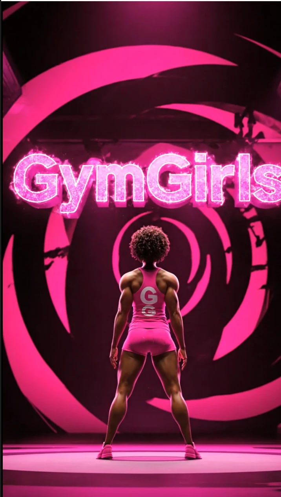
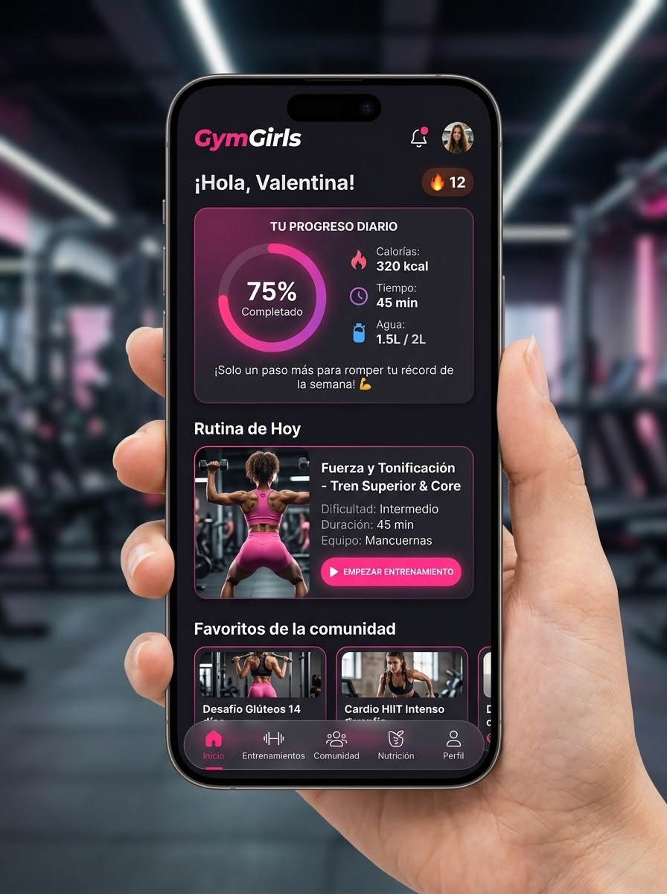
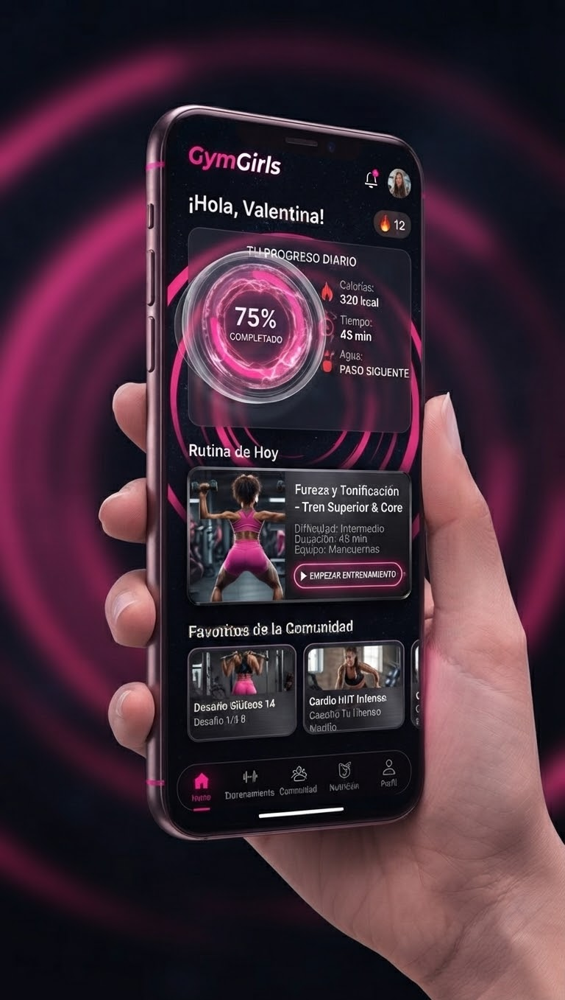

# GymGirls — Identidad de Marca

Documento de referencia visual para la app **GymGirls**. Basado en el arte clave de la marca (logotipo + key visual) y pensado para guiar el diseño de UI dentro de este proyecto Next.js.



> Si la imagen no se ve, es porque todavía no se guardó el archivo en `public/brand/`. Ver sección **Assets** al final.

---

## 1. Concepto de marca

GymGirls transmite **fuerza femenina, confianza y energía nocturna de gimnasio**. La estética mezcla:

- **Power / fitness**: figura atlética muy definida, pose frontal de espaldas, postura firme y centrada — transmite dominio y seguridad.
- **Neon / nightlife**: el logotipo brilla como cartel de neón sobre fondo oscuro, generando un efecto "sala de entrenamiento premium / arena" más que "gimnasio de barrio".
- **Movimiento / energía**: anillos concéntricos tipo onda expansiva o espiral detrás del logo sugieren impulso, ritmo, vibración — ideal para una app orientada a entrenamiento y progreso.

**Tono de voz sugerido:** directo, motivador, empoderador, sin tecnicismos. Frases cortas, imperativas, en segunda persona ("Entrená fuerte", "Tu progreso, tu poder").

---

## 2. Paleta de colores

El universo cromático es prácticamente monocromático: **negro + magenta/fucsia**, con blanco como acento de alto contraste para texto y detalles. Esto da un look premium, nocturno y fácil de usar en dark mode.

| Rol | Color | Hex (aprox.) | Uso |
|---|---|---|---|
| **Primario — Magenta GymGirls** |  | `#FF2E92` | Color de marca principal: logo, CTAs, botones activos, acentos |
| **Primario oscuro — Fucsia profundo** |  | `#C2185B` | Gradientes, sombras de color, estados hover/pressed |
| **Glow / Neón claro** |  | `#FF8FD6` | Resplandor del logo, highlights, bordes luminosos |
| **Rosa pastel (soporte)** |  | `#FFD3EC` | Fondos de tarjetas claras, texto sobre magenta, detalles suaves |
| **Fondo — Negro profundo** |  | `#0A0208` | Fondo base de pantallas, modo oscuro por defecto |
| **Negro secundario** |  | `#160010` | Superficies elevadas (cards, modales) sobre el fondo negro |
| **Blanco** |  | `#FFFFFF` | Texto principal, logo, iconografía sobre fondo oscuro |

**Reglas de uso:**
- El fondo por defecto de la app es **negro** (`#0A0208`), no blanco. GymGirls es una marca *dark-first*.
- El magenta (`#FF2E92`) se usa con moderación como acento: CTAs, progreso, estados activos, badges. No pintar fondos enteros de magenta salvo en heroes/splash.
- Los degradados van de negro a magenta/fucsia (radial, como en el key visual), nunca magenta a un color frío.
- Evitar introducir colores fuera de esta familia (no verdes, azules o amarillos) salvo para estados funcionales puntuales (éxito/error), y en ese caso usarlos con moderación y alto contraste.

### Tokens sugeridos (Tailwind / CSS variables)

```css
:root {
  --gg-bg: #0a0208;
  --gg-surface: #160010;
  --gg-primary: #ff2e92;
  --gg-primary-dark: #c2185b;
  --gg-glow: #ff8fd6;
  --gg-pastel: #ffd3ec;
  --gg-foreground: #ffffff;
}
```

---

## 3. Tipografía

### Logotipo / Display
El wordmark **"GymGirls"** usa una tipografía **sans-serif redondeada, extra bold / black**, de trazo grueso y uniforme, con tratamiento de neón (relleno claro + resplandor magenta exterior). Para producción recomendamos una fuente geométrica redondeada disponible en Google Fonts que capture el mismo espíritu:

- **Fredoka** (ExtraBold/Black) — preferida, por el carácter redondeado y amigable con peso fuerte.
- Alternativas: **Baloo 2** (ExtraBold), **Poppins** (Black), **Montserrat** (Black).

Uso: títulos grandes, splash screen, nombre de la app, headers de sección hero. Siempre en mayúsculas o Title Case, con tracking ligeramente ajustado (-1% a -2%).

### Monograma "GG"
En la ropa de la key visual aparece un monograma **"GG"** apilado, en versalitas, mismo peso extra bold que el wordmark — se puede reutilizar como ícono de app / favicon / avatar placeholder.

### UI / Texto de interfaz
Para cuerpo de texto, formularios, listados y datos (legibilidad en pantallas chicas), usar una sans-serif neutra y muy legible, **distinta** de la tipografía display:

- **Inter** o **Geist Sans** (ya incluida en el boilerplate de Next.js) para texto general.
- **Geist Mono** / **JetBrains Mono** para datos numéricos (pesos, repeticiones, tiempos, contadores).

| Uso | Fuente | Peso |
|---|---|---|
| Logo / Hero / H1 | Fredoka | 700–900 (Bold/Black) |
| H2–H3 | Fredoka o Poppins | 600–700 |
| Cuerpo de texto | Inter / Geist Sans | 400–500 |
| Botones / CTAs | Inter / Geist Sans | 600 (SemiBold) |
| Datos numéricos, stats | Geist Mono | 500–700 |

---

## 4. Logo y efecto neón

El tratamiento característico del logotipo es un **glow de neón**:

1. Texto base en blanco o rosa muy claro (`#FFD3EC`).
2. Resplandor exterior en magenta (`#FF2E92` → `#FF8FD6`), simulado con múltiples `text-shadow` o `filter: drop-shadow` desenfocados.
3. Fondo oscuro detrás para que el contraste del neón resalte.

Ejemplo CSS de referencia:

```css
.gg-logo {
  color: #ffe6f6;
  text-shadow:
    0 0 6px #ff8fd6,
    0 0 18px #ff2e92,
    0 0 40px #c2185b;
}
```

**No usar** el efecto neón en textos largos o de UI cotidiana — reservarlo para el logotipo, splash screen y momentos "hero" (logros, celebraciones, onboarding).

---

## 5. Imagen y fotografía

- Figuras atléticas, en pose de poder (de espaldas, de frente, posturas firmes), transmitiendo fuerza real, no estereotipo "fitness influencer" pasivo.
- Iluminación dramática, alto contraste, fondo oscuro con acentos magenta/neón.
- Motivos gráficos de apoyo: **ondas concéntricas / espirales** tipo sonar, que comunican energía, pulso, progreso — útiles como fondo decorativo en splash, loaders o estados vacíos.
- Evitar fotografía plana, luz natural "lifestyle" clara — rompe el tono nocturno/premium de la marca.

---

## 6. Resumen rápido (cheat sheet)

- **Fondo:** negro (`#0A0208`)
- **Color de marca:** magenta/fucsia neón (`#FF2E92`)
- **Acento de resplandor:** rosa neón claro (`#FF8FD6`)
- **Texto principal:** blanco (`#FFFFFF`)
- **Tipografía display:** Fredoka ExtraBold/Black (o Poppins/Montserrat Black)
- **Tipografía UI:** Inter / Geist Sans
- **Efecto distintivo:** glow de neón en el logotipo sobre fondo oscuro
- **Mood:** fuerza, confianza, energía nocturna, poder femenino

---

## 7. Mockup de UI (referencia de pantallas)

Además del key visual, se generó con IA (Gemini) una propuesta de cómo se vería la **Home** de la app aplicando esta identidad. Sirve como referencia directa de layout, jerarquía y tono de UI — no es pixel-perfect ni definitivo, pero es un muy buen punto de partida.



### 7.1 Layout de la pantalla (Home)

De arriba hacia abajo:

1. **Header**: wordmark "GymGirls" arriba a la izquierda (logo chico, misma tipografía redondeada del key visual, en degradé blanco → magenta). A la derecha, ícono de campana de notificaciones (con badge rojo de "hay novedades") y avatar de perfil circular.
2. **Saludo personalizado**: `¡Hola, Valentina!` en grande, más un badge tipo pill oscuro con racha/streak (`🔥 12`) a la derecha — gamificación visible desde el primer vistazo.
3. **Card "Tu progreso diario"**: tarjeta oscura elevada (más clara que el fondo, bordes muy redondeados). Contiene:
   - Un **donut/progress ring** grande con degradé magenta → violeta, con el `75%` y "Completado" centrados en blanco.
   - A la derecha, 3 métricas en lista con ícono + label + valor: Calorías (320 kcal), Tiempo (45 min), Agua (1.5L / 2L).
   - Debajo, un mensaje motivacional corto con emoji (`¡Solo un paso más para romper tu récord de la semana! 👍`) — refuerza el tono de voz motivador definido en la sección 1.
4. **Sección "Rutina de Hoy"**: título de sección en blanco, seguido de una card horizontal grande: foto de la rutina a la izquierda (recortada en el mismo card, sin márgenes), y a la derecha el título de la rutina, metadatos en gris (Dificultad / Duración / Equipo) y un **botón CTA pill** sólido en magenta (`▶ EMPEZAR ENTRENAMIENTO`, texto blanco, mayúsculas, con ícono de play).
5. **Sección "Favoritos de la comunidad"**: carrusel horizontal de cards más chicas (foto + título debajo), formato catálogo/descubrimiento.
6. **Bottom navigation**: barra inferior oscura con 5 ítems (Inicio, Entrenamientos, Comunidad, Nutrición, Perfil), cada uno con ícono + label. El ítem activo (Inicio) se destaca en magenta con un pequeño indicador debajo; el resto queda en gris/blanco apagado.

### 7.2 Patrones de componentes que confirma el mockup

- **Cards oscuras elevadas**: no son negro puro como el fondo — son un gris-violeta muy oscuro, apenas más claro que el fondo, con esquinas muy redondeadas (~20–24px). Esto da la sensación de profundidad sin usar bordes duros.
- **Botones CTA**: siempre pill (border-radius total), fondo magenta sólido, texto blanco en mayúsculas, con ícono a la izquierda. Es el único elemento con color sólido fuerte a página completa — todo lo demás es oscuro con acentos.
- **Data viz con degradé**: el progress ring usa un **degradé magenta → violeta/púrpura** (no el magenta plano del logo). Esto sugiere un segundo rango de color para gráficos y progreso, complementario a la paleta base.
- **Gamificación visible**: racha (streak), porcentaje de progreso diario y mensajes motivacionales están siempre a la vista en la pantalla principal — es un pilar de UX, no solo de estética.
- **Fotografía real integrada en cards**: las fotos de rutinas/comunidad se insertan directo dentro de las cards (sin recorte circular ni marcos), con la misma iluminación oscura/rosada del key visual, manteniendo coherencia entre foto real y UI.
- **Jerarquía tipográfica clara**: título de app y saludo en el peso más grueso (bold/extrabold redondeado); títulos de sección y de card en bold estándar; metadatos y texto secundario en gris, peso regular, tamaño chico; números clave (75%, 320 kcal, 45 min) siempre en blanco y bold para que destaquen sobre el gris de las labels.
- **Bottom nav flotante tipo pill/bar oscura**: ícono + texto, estado activo marcado solo con color (magenta) y un indicador fino, sin fondos ni botones grandes — mantiene la barra liviana.

### 7.3 Ajuste de paleta sugerido a partir del mockup

El mockup matiza la paleta "negro + magenta" del key visual (sección 2) con dos variaciones útiles para UI real:

| Rol | Hex (aprox.) | Uso |
|---|---|---|
| Fondo de pantalla | `#0E0E13` | Ligeramente más neutro/azulado que el negro-magenta del key visual, mejor para largas sesiones de lectura |
| Superficie de card | `#1C1A22` | Cards, modales, bottom nav — un escalón por encima del fondo |
| Degradé de progreso/datos | `#FF2E92` → `#8E2DE2` | Progress rings, barras de progreso, gráficos — magenta a violeta, en vez de magenta plano |
| Texto secundario / metadatos | `#9A96A3` | Labels tipo "Dificultad", "Duración", fechas, subtítulos |

Con esto, la paleta final de producto queda en **tres capas**: fondo casi negro, cards gris-violeta oscuro, y acentos magenta (sólido para CTAs, degradé magenta-violeta para data viz).

---

## 8. Fondo animado — el elemento clave de la marca

Este es el elemento más importante a implementar: **la app no tiene un fondo estático, tiene un fondo vivo**.



### 8.1 Qué se ve en la referencia

En esta segunda variante del mockup (misma Home que la sección 7) el fondo ya no es negro liso: detrás de las cards hay un **patrón de anillos concéntricos hecho de segmentos curvos** (como arcos o "pétalos" con puntas, no círculos continuos) en magenta/rosa sobre negro — el mismo motivo gráfico que aparece en el key visual original (sección 2), donde el logo "GymGirls" y la modelo están parados delante de esos arcos espiralados tipo radar/sonar.

En esta versión aplicada a la UI:

- El patrón de anillos queda **detrás de todo el contenido**, centrado aproximadamente en la zona superior de la pantalla (altura del header / card de progreso), e irradia hacia afuera perdiéndose hacia los bordes y hacia abajo.
- Las **cards dejan de ser sólidas**: ahora son **semi-transparentes con blur** (glassmorphism) — se ve el rosa del fondo "a través" de la card de progreso diario, de la card de rutina y de la bottom nav. Esto es un cambio de dirección respecto a la sección 7 (donde las cards eran opacas) y queda como la referencia más reciente/definitiva.
- El donut de "75% Completado" ya no es un ring plano: tiene textura/profundidad, como si el mismo patrón de anillos del fondo se "concentrara" ahí — refuerza que el fondo y los indicadores de progreso son el mismo lenguaje visual.

### 8.2 Descripción del patrón gráfico (para construirlo en vectores)

El motivo (visible mejor en el key visual de la sección 2) consiste en:

- Varios **anillos concéntricos**, no como círculos continuos sino cortados en **segmentos/arcos tipo "C"**, cada uno con las puntas afinadas (como pétalos, comas o aspas), no redondeadas parejas.
- Los segmentos de cada anillo están **rotados/desfasados** entre sí (no alineados radialmente), dando sensación de dinamismo, como paletas de un ventilador o una onda expansiva congelada en el tiempo.
- El tamaño, grosor y espaciado de los anillos crece del centro hacia afuera — más denso y angosto cerca del centro, más ancho y espaciado en los anillos exteriores.
- Todo en **un solo color** (magenta/fucsia) con variación de opacidad y algo de glow, nunca multicolor — así mantiene la identidad mono-cromática de la marca (sección 2).

### 8.3 Comportamiento esperado: fondo animado y reactivo

Esto **no es una imagen fija**: tiene que construirse con **vectores (SVG/Canvas, no un PNG/JPG estático)** para poder animarlo en tiempo real. Requisitos funcionales:

1. **Rotación continua**: los anillos giran todo el tiempo, cada anillo a velocidad y sentido distintos (algunos en sentido horario, otros antihorario, distintas velocidades) para que el patrón nunca se vea repetitivo ni mecánico.
2. **Variación semi-aleatoria**: además de rotar, los segmentos pueden ir cambiando levemente de tamaño/opacidad/posición con el tiempo (ruido/easing aleatorio, no un loop perfecto de 2 segundos que se note repetido) — la sensación es de "energía viva", no de un GIF en loop.
3. **Las cards van siempre adelante**: todo el contenido de la UI (cards, texto, botones) se renderiza en una capa por encima del fondo animado. Las cards usan **glass/blur** (fondo semi-transparente + `backdrop-filter: blur()`) para que el movimiento del fondo se perciba "a través" de ellas sin robarle legibilidad al contenido.
4. **El fondo reacciona al estado de la app** (esto es lo central del concepto):
   - **Durante un cronómetro/temporizador de entrenamiento activo**: el giro de los anillos puede acelerarse o pulsar en sincronía con el tiempo que corre (por ejemplo, un anillo "late" junto con los segundos, o la velocidad de rotación sube a medida que se acerca el final de la serie).
   - **Al cumplir una meta** (ej. llegar al 100% del progreso diario, terminar una repetición objetivo): el patrón puede tener un "pulso"/destello — una onda expansiva adicional que sale del centro, como celebración visual.
   - **Al terminar un entrenamiento completo**: una animación más grande/especial del fondo (más anillos, más brillo, rotación más rápida unos segundos) a modo de celebración, antes de volver al estado "idle" (rotación lenta de base).
   - En reposo (sin temporizador activo), el fondo queda en un estado "idle": rotación lenta y constante, de baja intensidad, para no distraer durante navegación normal.

### 8.4 Notas de implementación (para cuando se construya)

- Construir el patrón como **SVG** (grupo de `<path>` tipo arco, con `stroke-linecap` afinado/en punta) agrupados en anillos (`<g>` por anillo), cada `<g>` animado con rotación propia vía CSS (`@keyframes` + `transform: rotate()`) o con una librería de animación (Framer Motion / GSAP) si se necesita más control sobre "pulsos" y reacciones a eventos.
- Alternativa performante para muchos anillos/segmentos o para efectos de partículas al completar metas: **Canvas** o **WebGL** (ej. vía `<canvas>` + requestAnimationFrame, o una librería tipo `pixi.js`), especialmente si más adelante se suman partículas, blur dinámico o distorsión.
- El fondo debe vivir en un componente propio (ej. `AnimatedBackground`) montado una sola vez a nivel de layout, que exponga algo como un estado/prop `mode: "idle" | "timer" | "goalReached" | "workoutComplete"` para que cualquier pantalla pueda "avisarle" al fondo que reaccione, sin tener que reimplementar el patrón en cada vista.
- Mantener siempre el color dentro de la paleta magenta/violeta ya definida (secciones 2 y 7.3) — la intensidad y velocidad comunican el estado, no el color.
- Cuidar performance en mobile: limitar la cantidad de anillos/segmentos animados simultáneamente, usar `will-change`/capas por GPU, y bajar a una versión más simple (menos anillos, sin "ruido" aleatorio) si se detecta un dispositivo de gama baja o `prefers-reduced-motion`.

---

## Estilo Póster (vigente desde 2026-11-27)

Dirección elegida para la app; donde contradiga lo anterior, manda esta sección.
Maqueta: `docs/propuesta-poster.html`.

- **Misma paleta.** Bloques planos de color, esquinas rectas y bordes marcados.
- **Titulares y botones:** Archivo condensada, peso 900, en mayúsculas.
- **Portada del alumno:** key visual a pantalla completa con titular gigante.
- **Entrenamiento:** un ejercicio por pantalla. Actividad sobre lima limón y
  descanso sobre rosa flúor, cada uno con diseño propio. El fondo animado vuelve en la celebración final.
- **Neón:** solo en login, registro e invitación.
- **Excepción de color:** lima limón `#E5FF00` y rosa flúor `#FF0A8A`, y celeste
  flúor `#00F0FF` (agua), solo para las validaciones visuales (ver `VALIDACIONES.md`).

---

## 9. Assets

- `public/brand/gymgirls-keyvisual.webp` — key visual original de marca (logo + modelo + patrón de anillos).
- `public/brand/gymgirls-ui-mockup.jpg` — mockup de Home generado con IA, referencia de layout/UI (cards opacas).
- `public/brand/gymgirls-ui-mockup-glass.jpg` — mismo mockup de Home con cards glass/transparentes sobre el fondo animado de anillos — referencia principal para la sección 8.

Esta carpeta puede además contener logotipo exportado (SVG/PNG), favicon y el monograma "GG" sueltos para reutilizar en la UI.

---

## Stack técnico

Proyecto [Next.js](https://nextjs.org) con App Router, TypeScript, Tailwind CSS y Firebase.

```bash
npm run dev
```

Abrí [http://localhost:3000](http://localhost:3000) para ver la app. El código principal vive en `src/app`.
